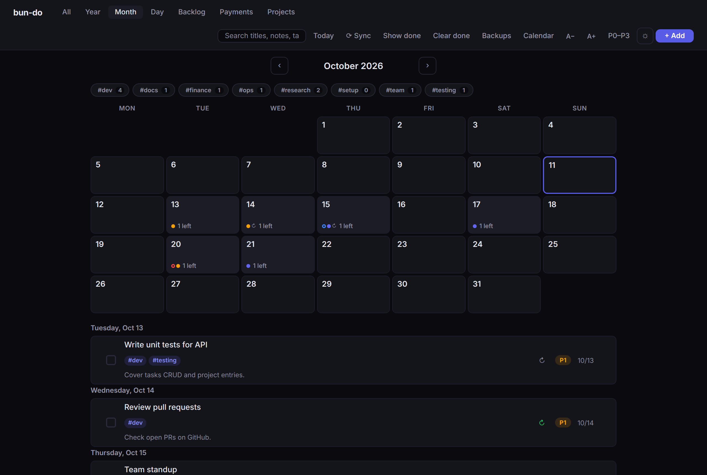
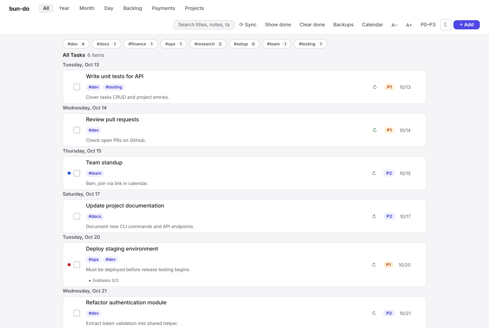
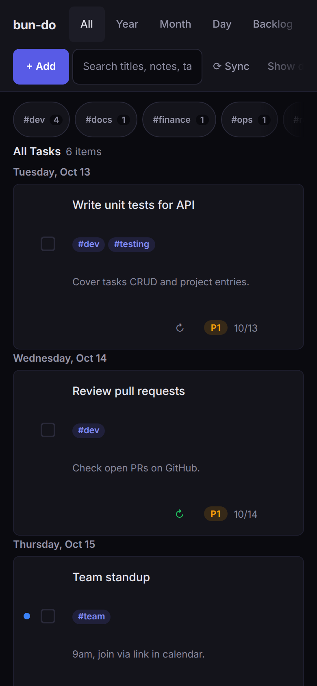

# bun-do

A local todo app built on [Bun](https://bun.sh). Your tasks live in plain JSON files on your own
computer, and you manage them in the browser, from the command line, or through an AI agent
(REST API, MCP server, Claude Code and OpenClaw skill). No account, no cloud, no runtime
dependencies.




<p>
  
  
</p>

## Quick start

```bash
bun install -g bun-do
bun-do open     # start the server in the background and open http://localhost:8000
```

`bunx bun-do` runs it without installing. Data goes to `~/.bun-do`. A new install starts empty
with a short guide and a button that loads example tasks.

## Features

**Views.** All, Year, Month (calendar), Day, Backlog, Payments and Projects.

**Tasks.**
- Priorities P0 (critical) to P3 (backlog), or Eisenhower matrix labels.
- Types: task, deadline, reminder and payment.
- Repeat rules: daily, weekdays (Monday to Friday), weekly, monthly or yearly, every 1 to 99
  days, weeks, months or years. Ticking a repeating task creates the next one. A monthly rule on
  the 31st lands on the last day of shorter months.
- Tags: type `#word` in a new task's title or use the Tags field. One tag filter works in every
  view, and search matches titles, notes and tags.
- Subtasks with drag-and-drop order, and notes.
- Titles, notes, tags and subtasks are edited in place.
- Open tasks from past days move to today; payments keep their due date.

**Payments.** Bills with an amount and currency, grouped by month with a total per month.

**Projects.** A short log of dated progress entries per project.

**Calendar feed.** `/calendar.ics` lets Apple Calendar, Outlook or Thunderbird show your tasks.
See [Calendar feed](#calendar-feed).

**Backups.** Before the first change of each day, the data files are copied to `backups/`.
Restore from the Backups dialog or the command line. See [Data and backups](#data-and-backups).

**Keyboard, screen reader, phone.**
- Shortcuts: `n` new task, `1` to `5` switch views, `/` search, `Esc` close a dialog,
  `Ctrl+S` sync now.
- Every control is a button with a name, the page behind an open dialog is inactive, and text
  meets WCAG AA contrast in the dark and the light theme.
- On a phone the header scrolls sideways and every control is at least 44 px.
- Font size buttons (A−, A+).

## Commands

```bash
bun-do                # same as start
bun-do start          # start the background server
bun-do stop           # stop it
bun-do restart        # restart it
bun-do status         # running or not, version, address, data directory, log file
bun-do open           # start and open in the browser
bun-do app            # open in a native macOS window (macOS only)
bun-do install-skill  # install the Claude Code skill (add --openclaw for OpenClaw)
bun-do backups        # list backups
bun-do restore <file> # restore a backup
bun-do help           # show all commands and options
bun-do --version      # print the version
```

Add `--port=9000` to use another port (default 8000). An unknown command prints the help and
exits with status 1. `status` exits with 1 when the server is not running.

The server listens only on `127.0.0.1` and refuses requests whose `Host` is not `localhost` or
`127.0.0.1`, so other computers and other websites cannot read or change your tasks.

## Use with AI agents

### MCP server

`bun-do-mcp` is a stdio MCP server with six tools: `list_tasks` (optional `tag`), `add_task`,
`update_task` (both take `tags`, `recurrence`, `amount` and `currency`), `delete_task`,
`list_projects` and `add_project_entry`. A failed call returns a result with `isError: true`.

Add it to `.mcp.json` or `claude_desktop_config.json`, and run `bun-do start` first:

```json
{
  "mcpServers": {
    "bun-do": { "command": "bun-do-mcp" }
  }
}
```

For another port, add `"env": { "BUNDO_PORT": "9000" }`.

### Claude Code skill

```bash
bun-do install-skill   # copies the skill to ~/.claude/skills/bun-do-api/SKILL.md
```

Start a new Claude Code session. Claude can then list, add, edit and delete tasks through the
REST API with `curl`.

### OpenClaw

[OpenClaw](https://github.com/openclaw/openclaw) is a personal AI assistant that runs on your
machine and takes messages from WhatsApp, Telegram, Slack, Discord and others. With the skill
installed, a message such as "add P1 task: fix the deployment, due tomorrow" becomes a task.

```bash
bun-do install-skill --openclaw   # copies to ~/.openclaw/workspace/skills/bun-do-api/SKILL.md
```

Restart OpenClaw to load it.

## Calendar feed

Click **Calendar** in the header for the subscription address, a copy button and a download link.
Apple Calendar, Outlook and Thunderbird on the same computer can subscribe to
`webcal://localhost:<port>/calendar.ics`. Google Calendar subscribes from Google's servers, which
cannot reach a server on your computer, so Google users download the `.ics` file and import it.

The feed holds open, dated tasks (backlog items stay out) as all-day events. Repeat rules become
`RRULE` lines, tags become `CATEGORIES`, and reminders get an alarm at 09:00. `?types=payment,deadline`
and `?tag=work` narrow the feed.

## Data and backups

All data is plain JSON in `BUNDO_DATA_DIR` (`~/.bun-do` when installed, `./data` in a source
checkout):

```
tasks.json            your tasks
projects.json         your projects
backups/              daily and before-restore copies
  tasks-YYYY-MM-DD.json
  projects-YYYY-MM-DD.json
bun-do.log, bun-do.pid  background server log and process id
```

Before the first change of each day, `tasks.json` and `projects.json` are copied to `backups/`.
The newest 30 copies of each are kept (`BUNDO_BACKUP_KEEP`). `bun-do backups` lists them and
`bun-do restore <file>` restores one, through the server when it runs or directly on the files
when it does not; the current file is saved as a before-restore copy first.

If `tasks.json` or `projects.json` cannot be read at startup, it is kept unchanged as
`<kind>.corrupt-<time>.json` and the newest readable backup is loaded in its place.

## Configuration

| Variable | Default | Meaning |
|---|---|---|
| `BUNDO_DATA_DIR` | `~/.bun-do` (installed), `./data` (source) | Directory for the data files and backups |
| `BUNDO_BACKUP_KEEP` | `30` | Backups kept of each kind (whole number, at least 1) |
| `BUNDO_PORT` | `8000` | Port that `bun-do-mcp` connects to |

```bash
export BUNDO_DATA_DIR=~/my-tasks
bun-do restart
```

## API

| Method | Endpoint | Description |
|---|---|---|
| `GET` | `/api/tasks` | List tasks (moves open tasks from past days to today). `?tag=` filters |
| `POST` | `/api/tasks` | Create a task |
| `PUT` | `/api/tasks/:id` | Update a task (send only the fields to change) |
| `DELETE` | `/api/tasks/:id` | Delete a task |
| `POST` | `/api/tasks/reorder` | Save the backlog order |
| `POST` | `/api/tasks/clear-done` | Remove completed tasks |
| `POST` | `/api/tasks/examples` | Load example tasks dated over the next two weeks |
| `POST` | `/api/tasks/:id/subtasks` | Add a subtask |
| `PUT` | `/api/tasks/:id/subtasks/:sid` | Update a subtask |
| `DELETE` | `/api/tasks/:id/subtasks/:sid` | Delete a subtask |
| `POST` | `/api/tasks/:id/subtasks/reorder` | Reorder subtasks |
| `GET` | `/api/projects` | List projects |
| `POST` | `/api/projects` | Create a project |
| `PUT` | `/api/projects/:id` | Update a project |
| `DELETE` | `/api/projects/:id` | Delete a project |
| `POST` | `/api/projects/:id/entries` | Add a log entry |
| `DELETE` | `/api/projects/:id/entries/:eid` | Delete a log entry |
| `GET` | `/api/backups` | List backups, newest first (file, kind, date, size, entries) |
| `POST` | `/api/backups/restore` | Restore a backup (`{"file": "<name>"}`); saves the current file first |
| `GET` | `/calendar.ics` | Calendar feed (`text/calendar`). Optional `?types=` and `?tag=` |

**Tags.** `tags` is a list of strings (`[]` when an older file has none). Create and update take a
list or one comma-separated string and replace the whole list. Each tag is trimmed, loses a
leading `#`, is lower-cased, has runs of spaces turned into `-`, and keeps only letters, digits,
`-` and `_`: at most 32 characters, 10 per task, no duplicates. `?tag=` is normalised the same way,
so `#WORK` matches `work`.

**Repeat rules.** `recurrence` is `null` or `{"type": "daily" | "weekdays" | "weekly" | "monthly" | "yearly", ...}`.
Weekly uses `dow` (0 = Monday to 6 = Sunday), monthly uses `day` (1 to 31), yearly uses `month`
(1 to 12) and `day`. `interval` (1 to 99) repeats every N days, weeks, months or years; weekdays
accepts only 1, and the value is stored only when above 1. A missing `dow`, `day` or `month` is
taken from the task's date. An invalid rule is refused with HTTP 400 and a `detail` that names
the field.

The full reference with `curl` examples is in [`skill/SKILL.md`](skill/SKILL.md), and a shorter
one for agents in [`AGENTS.md`](AGENTS.md).

## Development

```bash
git clone https://github.com/machine-made/bun-do.git
cd bun-do
bun install
bun run dev     # server on :8000, restarts on file changes
bun test        # API, CLI and MCP tests, each against a real server and a temporary data directory
```

Browser tests drive the web page in headless Chromium, including accessibility checks with
axe-core in both themes at desktop and phone width:

```bash
bunx playwright-core install chromium   # once
BUNDO_E2E=1 bun test test/e2e
```

`bun run screenshots` takes the screenshots in this README from the example tasks, in a temporary
data directory.

`./bin/bun-do start|stop|restart|status` runs a source checkout in the background;
`./bin/bun-do restart --example` reloads `data/tasks.example.json`.

### macOS window

`bun-do app` compiles a small Swift WKWebView wrapper on first run and opens the app in its own
window, without browser controls. It needs the Xcode command line tools
(`xcode-select --install`); the compiled program is kept in `~/.bun-do/app/`.

## Stack

| Layer | Tech |
|---|---|
| Runtime | [Bun](https://bun.sh) |
| Server | `Bun.serve()`, no dependencies |
| Frontend | [Alpine.js](https://alpinejs.dev) and [SortableJS](https://sortablejs.github.io/Sortable/), vendored, works offline |
| Storage | Plain JSON files |

## License

BSD-3-Clause

## Disclaimer

This software is provided "as is", without warranty of any kind. To the extent
permitted by law, the authors and contributors are not liable for any damage, loss
or claim arising from its use or misuse. You are responsible for how you use it and
for following the laws and rules that apply to you. The full terms are in
[LICENSE](LICENSE).

Your tasks are stored in local files on your computer. You are responsible for
backing them up, and for who can reach the server if you expose it to a network.
